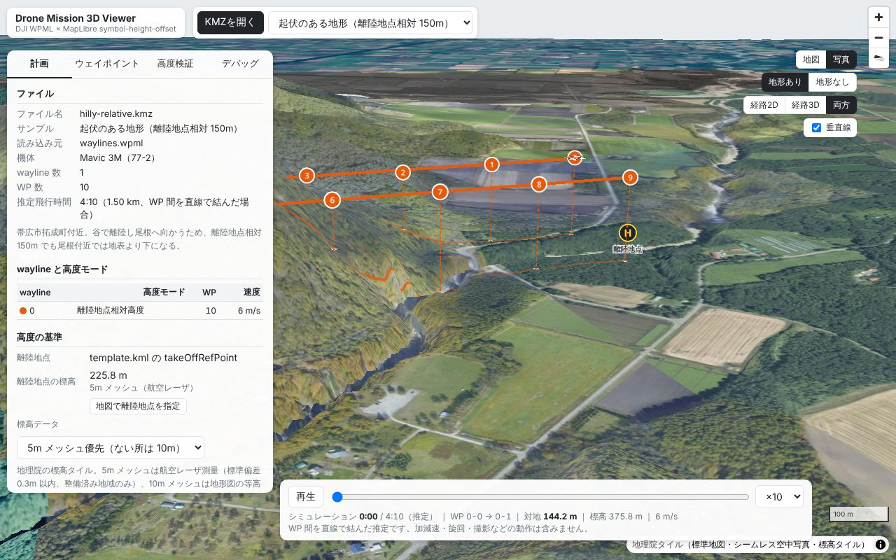

# Drone Mission 3D Viewer

DJI の飛行計画ファイル（KMZ / WPML）を読み込み、MapLibre GL JS v6.6 で追加された `symbol-height-offset` を使ってウェイポイントを地図上の空中に表示する Web アプリです。DJI Mavic 3M の飛行計画を主な対象にしています。

WPML に記録された高さ（離陸地点相対・楕円体高など）と、MapLibre が使う高さ（地表からの高さ・海面からの高さ）の基準の違いを確認することを目的にしています。



## できること

- KMZ のドラッグ＆ドロップ／ファイル選択で読み込み（解析はすべてブラウザ内。ファイルは外部に送信しない）
- `wpmz/waylines.wpml` の解析（複数 wayline 対応）。ない場合は `template.kml` から取得できる範囲で表示
- ウェイポイントを `symbol-height-offset` で空中に配置。`symbol-height-anchor` の `ground` / `absolute` を切り替え可能
- 高度変換（離陸地点相対・楕円体高・EGM96・AGL）。変換できない値は空中に置かず「参考」「未対応」として表示
- 地理院タイル（標準地図／写真）と地理院標高タイルによる 3D Terrain、地形の誇張
- 標高は 5m メッシュ（航空レーザ）を優先し、ない所は 10m メッシュで補う。高度換算と地図の地形に同じデータを使う
- 地表に投影した 2D 経路と、Three.js による高さ付きの 3D 経路・垂直線
- ウェイポイント一覧、詳細表示、地図上のクリックで高度・速度を表示
- 高度検証パネル（ピッチ、重なり、誇張、`queryTerrainElevation()` との比較）
- 解析結果を確認するデバッグパネル
- 推定飛行アニメーション（再生・一時停止・速度切り替え・シーク）
- スマートフォン表示

## 使い方

```bash
npm install
npm run dev
```

ブラウザで表示された URL を開き、KMZ をドロップするか、画面上部のメニューからサンプルを選びます。`?sample=hilly-relative.kmz` のように URL でサンプルを指定することもできます。

### 楕円体高（WGS84）の飛行計画を読むとき

`executeHeightMode` が `WGS84` の場合、高さは楕円体高です。標高に直すにはジオイド高が必要なので、「計画」タブで入力してください（帯広付近で約 29.5m。[国土地理院のジオイド高計算](https://vldb.gsi.go.jp/sokuchi/surveycalc/geoid/calcgh/calc_f.html)で確認できます）。未入力の間は地表に参考表示します。

### 離陸地点相対の飛行計画を読むとき

`template.kml` の `takeOffRefPoint` を離陸地点として使います。記録がない場合は最初のウェイポイントの直下を仮の離陸地点にして「参考」表示します。「地図で離陸地点を指定」で実際の離陸地点を設定できます。

## コマンド

| コマンド | 内容 |
|---|---|
| `npm run dev` | 開発サーバー |
| `npm test` | ユニットテスト（パーサー、高度変換、DEM、タイムライン） |
| `npm run build` | 型チェックと本番ビルド（`dist/`） |
| `npm run preview` | ビルド結果の確認 |
| `npm run samples` | サンプル KMZ の再生成（地理院 DEM を取得） |
| `npx tsx scripts/compare-dem.ts` | サンプル地点の 10m / 5m / 1m メッシュの標高を比較 |
| `node scripts/screenshots.mjs` | 検証用スクリーンショットの撮影（Playwright が必要） |

## 構成

```
src/
  wpml/parser.ts          KMZ / WPML の解析
  wpml/geojson.ts         高度変換結果を GeoJSON に変換
  altitude/altitude.ts    高度変換（UI・地図に依存しない）
  terrain/gsiDem.ts       地理院標高タイルのデコードと DEM サンプラー
  terrain/browserDem.ts   ブラウザ用ローダー、MapLibre 用の Terrarium 変換プロトコル
  map/mapView.ts          MapLibre の地図・レイヤー
  map/threeRouteLayer.ts  Three.js の Custom Layer（3D 経路・垂直線）
  animation/timeline.ts   推定飛行タイムライン
  main.ts                 画面の制御
test/                     ユニットテスト（Vitest）
scripts/                  サンプル KMZ 生成、スクリーンショット
public/samples/           サンプル KMZ
docs/                     調査メモ、データ仕様、検証結果、記事下書き
```

## ドキュメント

- [仕様調査メモ](./docs/research.md)
- [データ仕様](./docs/data-spec.md)
- [飛行計画の高度検証結果](./docs/verification.md)
- [Advent Calendar 記事下書き](./docs/article-draft.md)

## デプロイ（Cloudflare Pages）

静的サイトとして `dist/` を配信します。

```bash
npm run build
npx wrangler pages deploy
```

GitHub Actions（`.github/workflows/deploy.yml`）は main への push でテスト・ビルドし、リポジトリのシークレット `CLOUDFLARE_API_TOKEN` と `CLOUDFLARE_ACCOUNT_ID` があれば Cloudflare Pages（プロジェクト名 `maplibre-drone-flight-3d`）にデプロイします。

## デプロイ（GitHub Pages）

`.github/workflows/pages.yml` が main への push（または手動実行）でビルドし、GitHub Pages に公開します。リポジトリの Settings → Pages → Build and deployment の Source を「GitHub Actions」にしておく必要があります。ビルドは相対パス（`base: './'`）なので `https://<user>.github.io/<repo>/` のようなサブパスでも動きます。

## 実機の KMZ を追加するとき

1. DJI Pilot 2 から KMZ を書き出し、画面にドロップする
2. 「デバッグ」タブで、`wpmlNamespace`、`missionConfig`（`droneEnumValue` など）、wayline と高度モードが読めているか確認する
3. 共有してよいファイルなら `public/samples/` に置き、`public/samples/index.json` に追記する（`npm run samples` を実行すると index.json は作り直されるので注意）

## 制限事項

- 標高は地理院標高タイル（日本国内）を使います。国外では地形が平坦（0m）になり、高度換算もできません。
- DJI の EGM96 と地理院 DEM（日本のジオイド）の差は補正していません。5m メッシュのない地域は 10m メッシュ（標準偏差 5m 以内）になります。
- 3D 経路とアニメーションはウェイポイント間を直線で結んだものです。実際の飛行軌跡・時間ではありません。
- Mavic 3M の機体コード（`77-2`、ペイロード `68`）は公式の製品一覧に記載がなく、実機ファイルでの確認が必要です。

## 出典・ライセンス

- 地図・標高: [地理院タイル](https://maps.gsi.go.jp/development/ichiran.html)（標準地図、全国最新写真（シームレス）、標高タイル）
- ラベル用フォント: MapLibre デモタイルのグリフ
- DJI WPML 仕様: [DJI Cloud API Documentation](https://developer.dji.com/doc/cloud-api-tutorial/en/api-reference/dji-wpml/overview.html)

MIT License
