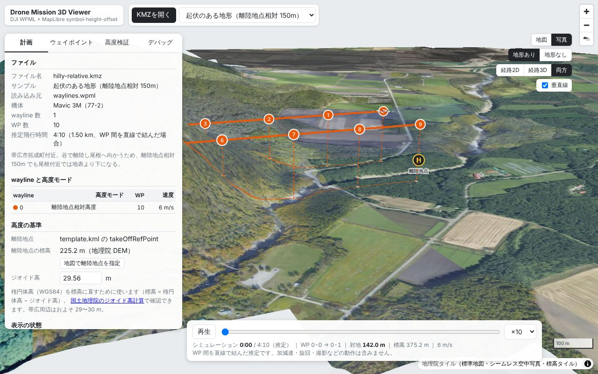
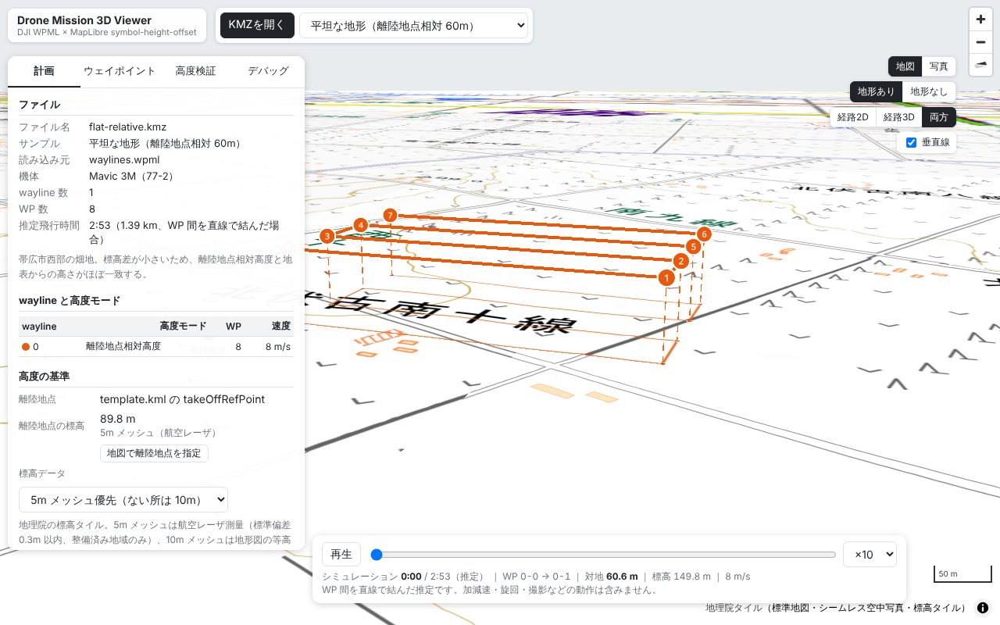
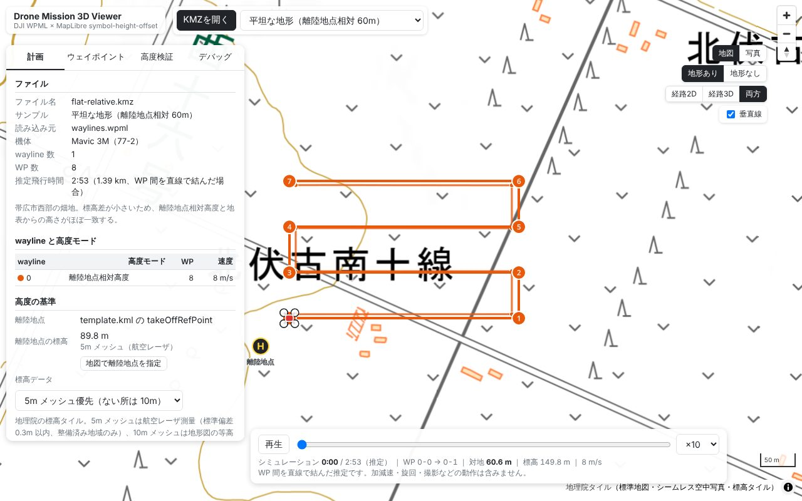
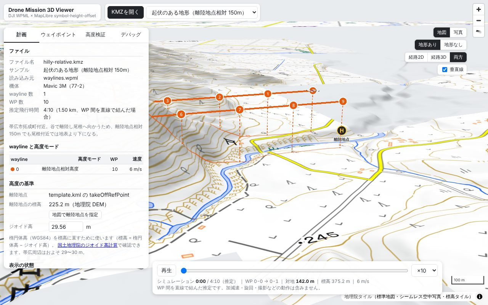
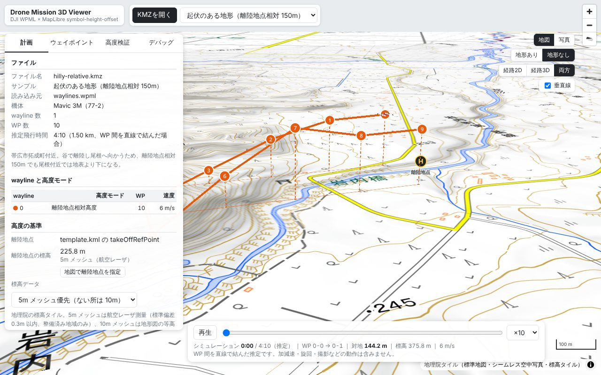
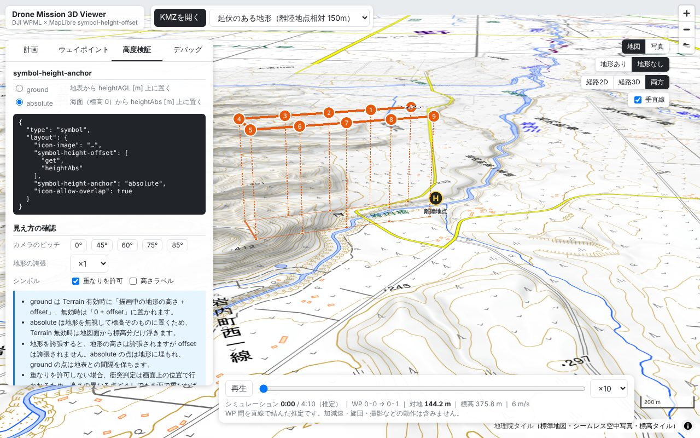
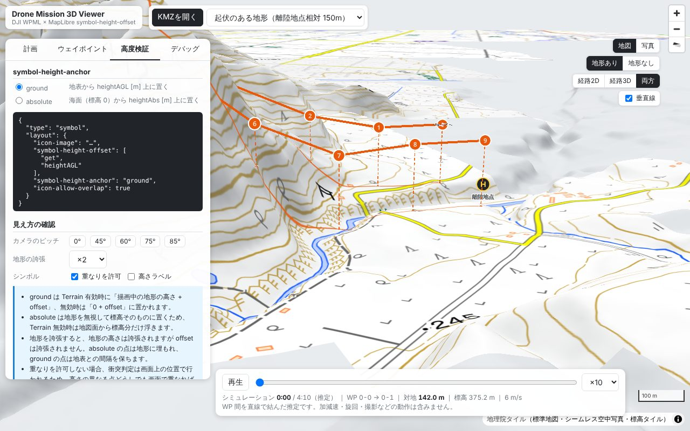
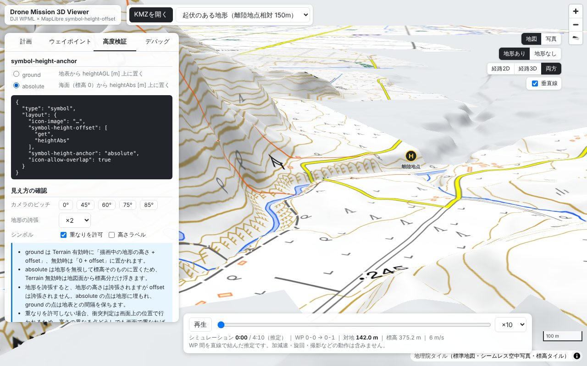
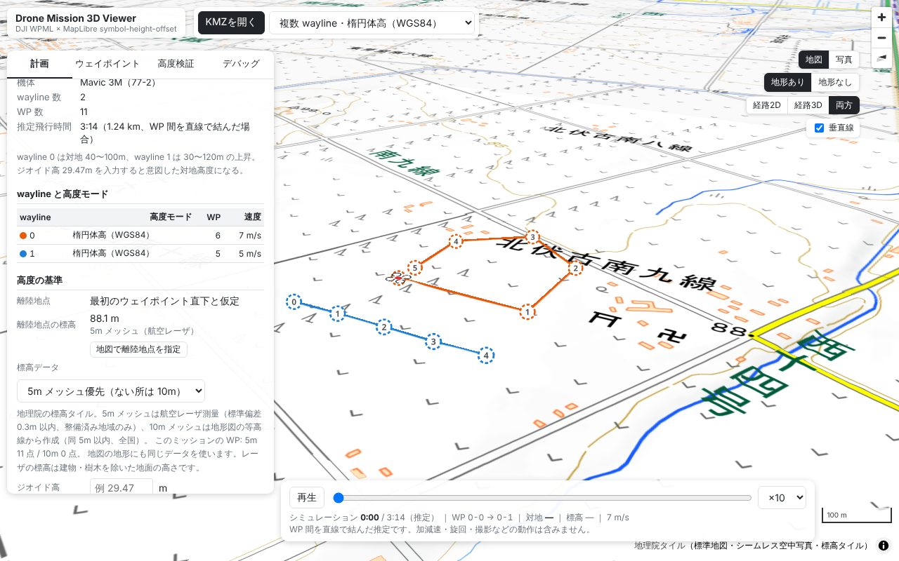
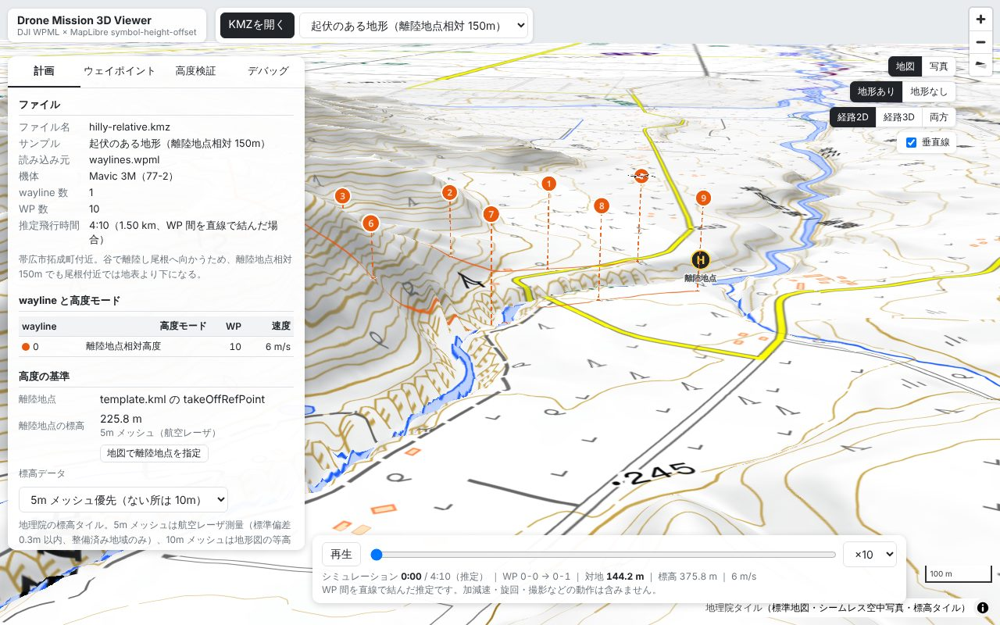

# MapLibre GL JS v6.6の新機能「symbol-height-offset」でDJI WPMLの飛行計画を3D可視化してみた

この記事は MapLibre Advent Calendar 2026 の ○日目の記事です。

ドローンの自動航行で使う飛行計画ファイル（DJI の KMZ / WPML）を、MapLibre GL JS の `symbol-height-offset` を使って地図の上の空中に表示してみました。やってみると、表示そのものより「その高さは何から測った高さなのか」をそろえる部分に手間がかかったので、そのあたりを中心に書きます。

- デモ: https://shinyanakashima.github.io/maplibre-symbol-height-offset-drone/
- ソース: https://github.com/shinyanakashima/maplibre-symbol-height-offset-drone



## 1. MapLibre GL JS v6.6 で追加された機能

v6.6.0 で、symbol レイヤーに次の 2 つのレイアウトプロパティが入りました。

| プロパティ | 内容 |
|---|---|
| `symbol-height-offset` | シンボルを置く高さ（m）。data-driven（feature の属性を参照できる） |
| `symbol-height-anchor` | 高さの基準。`ground`（地表から、既定）/ `absolute`（海面から） |

これまで MapLibre でアイコンを「空中」に置くには、Custom Layer で自前で描くか、`fill-extrusion` で柱を立てるくらいしか方法がありませんでした。v6.6 からは普通の symbol レイヤーで、アイコンや文字を高さ付きで置けます。

なお、スタイル仕様書の sdk-support 表では `symbol-height-anchor` の JS 対応が issue へのリンクのままですが、npm の 6.6.0 のソースにはすでに実装が入っていました。また 6.8.0 で、高い位置のシンボルが画面外のタイルに属していても読み込まれるようにする修正が入っています。今回は 6.19.0 を使いました。

## 2. symbol-height-offset の仕組み

使い方は普通のレイアウトプロパティと同じです。

```js
map.addLayer({
  id: 'waypoints',
  type: 'symbol',
  source: 'mission',
  layout: {
    'icon-image': 'wp',
    'symbol-height-offset': ['get', 'heightAGL'],
    'symbol-height-anchor': 'ground',
    'icon-allow-overlap': true,
  },
});
```

実際にどの高さに置かれるかは、ソースの `src/symbol/symbol_elevation.ts` を読むのが早いです。

```ts
export function getSymbolElevation(getElevation, x, y, heightOffset, heightAnchorGround) {
    if (!heightAnchorGround) {
        return heightOffset;                 // absolute
    }
    if (!getElevation) {
        return heightOffset !== 0 ? heightOffset : undefined;  // Terrain なし
    }
    return getElevation(x, y) + heightOffset;  // ground
}
```

まとめると次のとおりです。

| | Terrain あり | Terrain なし |
|---|---|---|
| `ground` | 描画中の地形の高さ + offset | 0 + offset |
| `absolute` | offset | offset |

`getElevation` は地形の誇張（exaggeration）を掛けた後の値なので、offset 自体は誇張されません。この点は後で効いてきます。

## 3. DJI WPML とは

DJI の業務用ドローン（Matrice シリーズ、Mavic 3 Enterprise シリーズなど）の飛行計画は、WPML（WayPoint Markup Language）という KML を拡張した形式で保存されます。ファイルは `.kmz`（中身は ZIP）です。

```
mission.kmz
└─ wpmz/
   ├─ template.kml    編集用のテンプレート（測量エリア、重複率など）
   └─ waylines.wpml   機体が実際に実行する経路
```

今回見るのは `waylines.wpml` のこの部分です。

```xml
<Folder>
  <wpml:executeHeightMode>relativeToStartPoint</wpml:executeHeightMode>
  <wpml:waylineId>0</wpml:waylineId>
  <wpml:autoFlightSpeed>6</wpml:autoFlightSpeed>
  <Placemark>
    <Point><coordinates>143.04,42.6745</coordinates></Point>
    <wpml:index>0</wpml:index>
    <wpml:executeHeight>150</wpml:executeHeight>
    <wpml:waypointSpeed>6</wpml:waypointSpeed>
  </Placemark>
</Folder>
```

`executeHeight` の基準は `executeHeightMode` で決まり、仕様では次の 3 つです。

| executeHeightMode | 意味 |
|---|---|
| `WGS84` | 楕円体高 |
| `relativeToStartPoint` | 離陸地点からの高さ |
| `realTimeFollowSurface` | リアルタイム地表追従（M3E/M3T/M3M のみ） |

どれも「その地点の地表からの高さ」ではありません。ここが今回の本題です。

## 4. KMZ の読み込みと解析

KMZ の展開は JSZip、XML の解析はブラウザ標準の DOMParser で行い、ファイルはサーバーに送りません。

注意したのは名前空間です。WPML の名前空間 URI は `http://www.dji.com/wpmz/1.0.2`、`1.0.6` のようにバージョンが入っていて、ファイルによって違います。そこで要素は「直下の子要素のローカル名」で探すことにしました。子孫まで検索すると、撮影アクションの中の要素などを拾ってしまうためです。

```ts
function child(el: Element | null, localName: string): Element | null {
  if (!el) return null;
  for (const c of Array.from(el.children)) {
    if (c.localName === localName) return c;
  }
  return null;
}
```

もう一つ、`template.kml` の離陸地点 `wpml:takeOffRefPoint` は「緯度,経度,楕円体高」の順で書かれています。KML の `coordinates`（経度,緯度）と逆なので、うっかりすると離陸地点が海の上に飛びます。

## 5. 空中ウェイポイントの表示

ウェイポイントを GeoJSON の Point にし、高さを属性に入れて `['get', 'heightAGL']` で参照します。Three.js で同じ高さに線を引いてみると、シンボルの位置と線の頂点がきれいに一致しました。



真上から見ても、透視投影なので画面の端の方では空中の点が地表の位置から少し外側にずれて見えます。



アイコンの衝突判定は画面上の位置で行われるので、高さの違う点同士でも画面で重なれば片方が消えます。空中の点は視点で大きく動くため、`icon-allow-overlap: true` にして、`symbol-sort-key` で高い点を手前に描くようにしました。

## 6. Terrain と高度基準の問題

### 離陸地点相対高度は「地表からの高さ」ではない

帯広市の南、拓成町付近の谷で離陸して、西の尾根に向かう計画を作りました。高さは離陸地点相対 150m です。

この値をそのまま `symbol-height-offset`（ground）に入れると、すべての点が地表から 150m 上に並びます。見た目は安全そうです。

実際には、離陸地点の標高は 225m、尾根の WP の地表は 402m と 422m あります。

```
AGL = 離陸地点の標高 + 離陸地点相対高度 − ウェイポイント地点の地表標高
    = 225.2 + 150 − 422.2
    = −47.0 m
```

地面の中です。換算してから表示すると、この 2 点は地形に隠れて見えなくなります。

| Terrain あり | Terrain なし |
|---|---|
|  |  |

標高は国土地理院の標高タイル（z14）から取りました。MapLibre の `raster-dem` は地理院タイルの形式（2 の補数・無効値あり）をそのまま読めないので、`addProtocol` で Terrarium 形式に変換して渡しています。離陸地点とウェイポイントの標高を同じ DEM から取れば、DEM の鉛直基準は引き算で消えます。

### absolute を使う方法

`absolute` なら「離陸地点の標高 + 相対高度」をそのまま渡せば済み、ウェイポイントごとに地表標高を調べる必要がありません。地形より下の点は自然に隠れます。



ただし Terrain を切ると、平らな地図から標高分（このサンプルでは 375m）浮いてしまいます。また地形を誇張すると、`absolute` の点は誇張された地形に埋もれます。

| ground（誇張 ×2） | absolute（誇張 ×2） |
|---|---|
|  |  |

Terrain の有無や誇張を切り替える画面では `ground` + 換算済みの AGL、地形との位置関係を正確に見たい場面では誇張 ×1 で `absolute`、と使い分けるのがよさそうです。

### 楕円体高とジオイド高

`WGS84`（楕円体高）の場合は、標高に直すためにジオイド高が必要です。帯広付近で約 29.5m なので、そのまま offset に入れると 30m 近く高く表示されます。

国土地理院のジオイド高計算サービスはブラウザから直接呼べない（CORS が許可されていない）ため、今回は画面で入力する形にしました。入力がない間は、間違った高さで空中に置くのではなく、地表に「参考」として置いて注意書きを出します。



### queryTerrainElevation() は換算には使いにくい

`map.queryTerrainElevation()` でも地表標高は取れますが、描画中のタイルのズームに依存します。ズーム 16 前後では DEM の値と 0.01m 以内で一致しましたが、ズーム 11 では最大 20m ほどずれ、タイルの読み込み途中ではもっと大きくずれました。Terrain を切ると `null` になります。そのため換算には DEM を直接読み、`queryTerrainElevation()` は確認用にしました。

### 実運用で必要になる情報

ここまでをまとめると、WPML の高さを MapLibre で正しく表すには、少なくとも次のどちらかが要ります。

| WPML の高度モード | `absolute` で置く場合 | `ground` で置く場合 |
|---|---|---|
| 離陸地点相対 | 離陸地点の標高 | 離陸地点の標高 + ウェイポイントごとの地表標高 |
| 楕円体高 | ジオイド高 | ジオイド高 + ウェイポイントごとの地表標高 |

ただし、離陸地点については注意が必要です。KMZ の `takeOffRefPoint` は計画時の参考値で、DJI の仕様にも「実行時は実際の離陸地点が優先される」とあります。機体は実際に飛び立った場所を基準に高さを測るため、計画と違う場所から飛ばすと空中の高さ全体がずれます。谷で計画して尾根から飛ばせば、数十 m 単位で変わります。

デモでは「地図で離陸地点を指定」で離陸予定地点を置き直せるようにしました。飛行後の確認であれば、フライトログに残る実際の離陸地点を使うのが確実です。起伏の大きい場所では、離陸地点に左右されない楕円体高で計画を作るほうが扱いやすいと感じました。

### DEM は何 m メッシュか

地表標高に使った地理院の標高タイル（`dem_png`）は、z14 まで「基盤地図情報 数値標高モデル」の 10m メッシュ（DEM10B）です。2.5 万分 1 地形図の等高線から作ったもので、標高の標準偏差は 5m 以内とされています。z14 のタイルの 1 ピクセルは帯広付近で約 7m ですが、元データの細かさは約 10m です。

同じ場所に航空レーザ測量の 5m メッシュ（DEM5A、`dem5a_png`、標準偏差 0.3m 以内）や 1m メッシュ（`dem1a_png`）があれば、そちらのほうが正確です。今回のサンプル地点では両方とも提供されていたので比べてみました。

| 地点 | DEM10B | DEM5A | DEM1A |
|---|---|---|---|
| 平坦地 離陸地点 | 92.20 | 89.81 | 89.77 |
| 起伏地 離陸地点 | 225.15 | 225.85 | 225.97 |
| 起伏地 WP4（尾根） | 401.73 | 410.30 | 410.02 |
| 起伏地 WP7（川沿い） | 223.23 | 207.88 | 提供なし |

（単位 m。`scripts/compare-dem.ts` で取得）

平坦な畑でも 10m メッシュは 2〜3m 高く、起伏地では 15m 違う点がありました。尾根の WP4 は、5m メッシュで計算し直すと AGL が −26.6m から −34.4m になります。5m と 1m の差は 0.5m 以内でした。

もう一つ、航空レーザの DEM は建物や樹木を除いた地面の高さです。森の上や作物の上を飛ぶ場合、機体と実際の障害物との間隔は、この AGL よりさらに小さくなります。

## 7. 3D 飛行経路への拡張

MapLibre の line レイヤーは高さを持てず、地表に沿って描かれます。空中の点を結ぶ線は Custom Layer で描く必要があるので、ここだけ Three.js（`Line2`）を使いました。

| 2D（line レイヤー） | 2D + 3D |
|---|---|
|  |  |

v6 で一つはまったのが行列です。`render(gl, options)` の `options.modelViewProjectionMatrix` はワールドピクセル座標用で、`MercatorCoordinate`（0〜1）で頂点を置くなら `options.defaultProjectionData.mainMatrix` を使います。前者を使うと何も表示されず、しばらく悩みました。

```ts
render(gl, options) {
  const mvp = new THREE.Matrix4().fromArray(options.defaultProjectionData.mainMatrix);
  const model = new THREE.Matrix4()
    .makeTranslation(origin.x, origin.y, origin.z)
    .scale(new THREE.Vector3(s, -s, s));   // s = origin.meterInMercatorCoordinateUnits()
  camera.projectionMatrix = mvp.multiply(model);
  renderer.resetState();
  renderer.render(scene, camera);
}
```

`renderingMode: '3d'` にすると MapLibre の深度バッファを共有するので、尾根の下をくぐる区間は地形に隠れます。なお、この線はウェイポイント間を直線で結んだだけのもので、実際の飛行軌跡ではありません。

おまけで、ウェイポイント間を移動するドローンのアイコンも付けました。これも symbol レイヤーで、毎フレーム `setData` で位置と `heightAGL` を更新しているだけです。

## 8. デモと検証結果

| 確認したこと | 結果 |
|---|---|
| 属性による高さ指定 | `['get', ...]` で WP ごとに異なる高さに置ける |
| Terrain あり / なし（ground） | 地形 + offset / 0 + offset |
| absolute | 地形を無視。Terrain なしでは標高分浮く |
| 地形の誇張 | offset は誇張されない。absolute の点は埋もれる |
| 地表より下の点 | 地形に隠れて表示されない |
| クリック判定 | 空中に描かれた位置で当たる |
| ピッチ 0° | 透視投影で画面端の点は外側にずれる |
| 重なり | 画面上の位置で判定される |
| 3D ライン | Custom Layer（`mainMatrix`）でシンボルと一致 |

詳しい数値はリポジトリの `docs/verification.md` にまとめました。

## 9. まとめ

- `symbol-height-offset` のおかげで、空中の点を symbol レイヤーだけで表現できるようになりました。属性で高さを渡せるので、GeoJSON を作るだけで済みます。
- 一方で、渡す値の基準をそろえるのは使う側の仕事です。DJI WPML の高さは「離陸地点から」や「楕円体から」で、そのまま入れると起伏のある場所では地面の中のウェイポイントを見逃します。
- `ground` と `absolute` は、Terrain の切り替えや誇張を使うかどうかで向き不向きがあります。
- 高さ付きの線はまだ Custom Layer の出番です。

次は、実機の Mavic 3M で作った計画ファイルを読み込んで、DJI Pilot 2 の表示と比べてみたいと思います。

### 参考

- MapLibre Style Spec: symbol-height-offset / symbol-height-anchor
- DJI Cloud API Documentation: DJI WPML（Overview / Template.kml / Waylines.wpml / Common Elements）
- 国土地理院: 地理院タイル一覧、標高タイルの仕様、ジオイド高計算
