# 飛行計画の高度検証結果

MapLibre GL JS 6.19.0、地理院 標高タイル（dem_png z14）、サンプル KMZ（`public/samples/`）で確認した結果。
画面は Headless Chromium（SwiftShader）で撮影した。`node scripts/screenshots.mjs` で再生成できる。

## 1. symbol-height-offset でウェイポイントを空中に置けるか

**置ける。** feature の属性を `['get', 'heightAGL']` で参照し、ウェイポイントごとに異なる高さに配置できた。

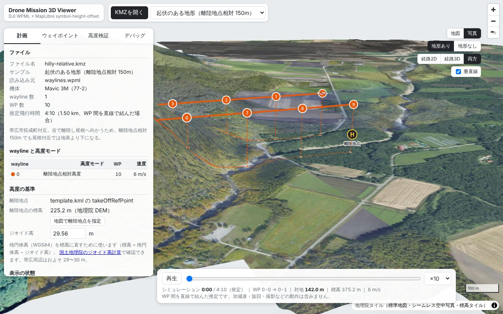

- 平坦な地形（帯広市西部）では、離陸地点相対 60m の WP が地表から 60.5〜63.8m に並ぶ（表 1）。
- Three.js で同じ高さに描いた 3D ラインの頂点とシンボルの位置が一致した。`symbol-height-offset` の基準面と、Custom Layer で `MercatorCoordinate` の z に与えた標高が同じ空間にあることが確認できる。
- 地図上のシンボルのクリック判定（`queryRenderedFeatures`）は、空中に描かれた位置で当たる。

## 2. Terrain 有効時と無効時の描画位置（symbol-height-anchor: ground）

| Terrain あり | Terrain なし |
|---|---|
| 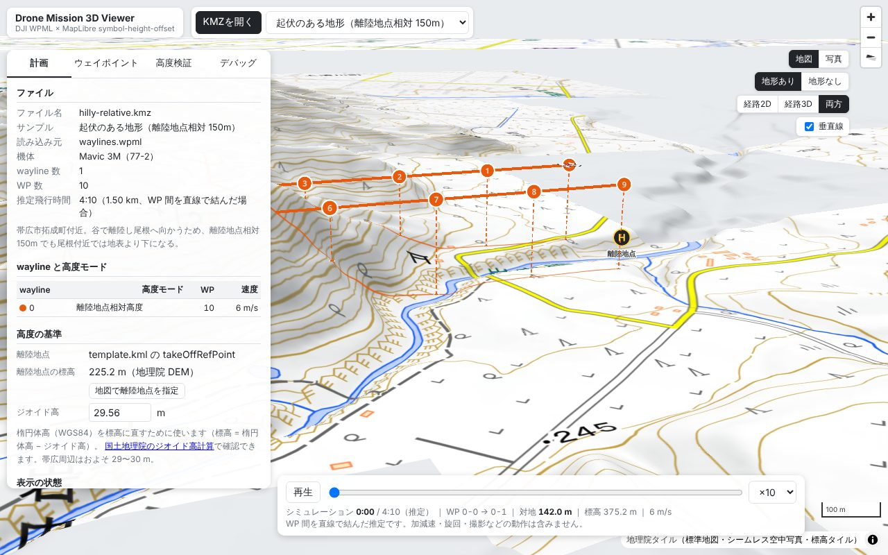 | 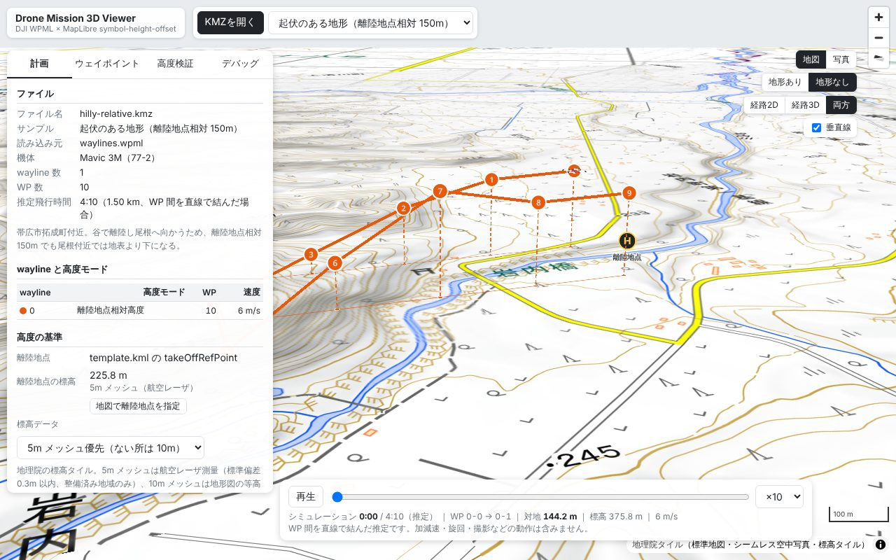 |

- Terrain ありでは「描画中の地形の高さ + offset」に置かれる。
- Terrain なしでは「0 + offset」、つまり平面の地図から AGL だけ浮いた位置に置かれる。AGL を正しく計算しておけば、Terrain の有無にかかわらず「地表からの高さ」の見た目は保たれる。
- 起伏のある地形のサンプルでは、谷（標高 225m）で離陸し、離陸地点相対 150m で尾根（標高 400m 超）へ向かうため、WP 4・5 が地表より下（AGL −26.6m、−47.0m）になる。Terrain ありでは、この 2 点は地形に隠れて表示されない（MapLibre が地形に遮られたシンボルを非表示・半透明にする）。

### 表 1 平坦な地形（flat-relative.kmz、離陸地点の DEM 標高 92.20m）

| WP | executeHeight | 地表標高（DEM） | AGL | 標高 |
|---|---|---|---|---|
| 0 | 60 | 91.72 | 60.47 | 152.20 |
| 1 | 60 | 90.55 | 61.65 | 152.20 |
| 2 | 60 | 89.86 | 62.34 | 152.20 |
| 3 | 60 | 91.65 | 60.54 | 152.20 |
| 4 | 60 | 91.55 | 60.64 | 152.20 |
| 5 | 60 | 89.05 | 63.15 | 152.20 |
| 6 | 60 | 88.39 | 63.81 | 152.20 |
| 7 | 60 | 91.56 | 60.64 | 152.20 |

### 表 2 起伏のある地形（hilly-relative.kmz、離陸地点の DEM 標高 225.15m）

| WP | executeHeight | 地表標高（DEM） | AGL | 標高 |
|---|---|---|---|---|
| 0 | 150 | 233.16 | 141.99 | 375.15 |
| 1 | 150 | 235.91 | 139.25 | 375.15 |
| 2 | 150 | 271.18 | 103.97 | 375.15 |
| 3 | 150 | 343.03 | 32.12 | 375.15 |
| 4 | 150 | 401.73 | **−26.57** | 375.15 |
| 5 | 150 | 422.16 | **−47.00** | 375.15 |
| 6 | 150 | 295.24 | 79.92 | 375.15 |
| 7 | 150 | 223.23 | 151.93 | 375.15 |
| 8 | 150 | 233.70 | 141.46 | 375.15 |
| 9 | 150 | 230.23 | 144.92 | 375.15 |

離陸地点相対高度は「離陸地点からの高さ」なので、WP 直下の地形が離陸地点より高ければ AGL はその分小さくなる。WPML の値をそのまま `symbol-height-offset`（ground）に入れると、WP 4・5 も地表 150m 上に表示され、危険な計画を見逃す。

## 3. symbol-height-anchor: absolute

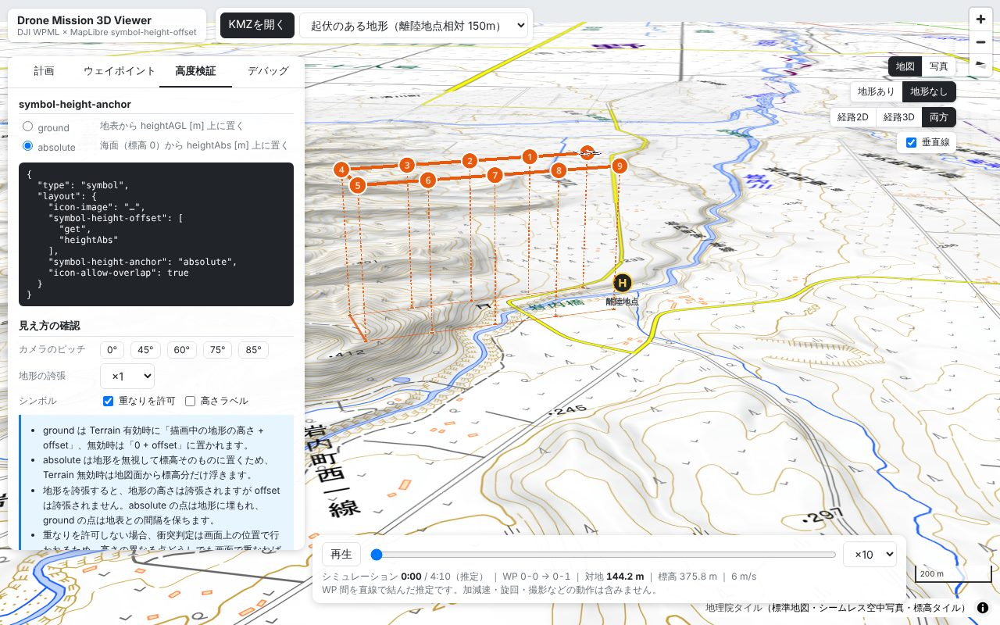

- `absolute` は地形を無視して海面から offset の高さに置く。標高（`heightAbs`）を渡すと、Terrain ありでは `ground` + AGL と同じ位置になった（地形の誇張なしの場合）。
- 離陸地点相対の場合、`absolute` なら「離陸地点の標高 + 相対高度」だけで置けるため、ウェイポイントごとに地表標高を調べる必要がない。WP が地表より下にあれば、地形に隠れて見えなくなる。
- Terrain なしでは、標高そのもの（このサンプルでは 375m）だけ平面の地図から浮く。Terrain を切り替える画面では `absolute` は使いにくい。

### 地形の誇張（exaggeration）との関係

| ground（×2） | absolute（×2） |
|---|---|
| 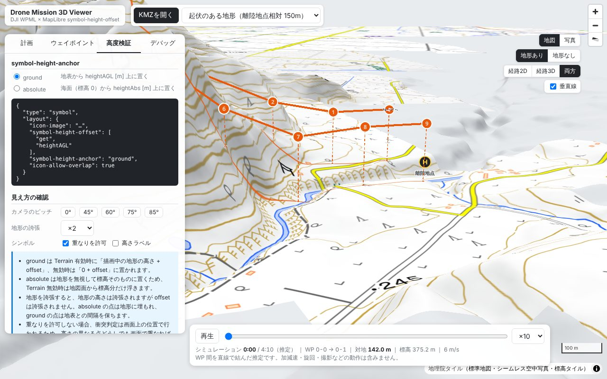 | 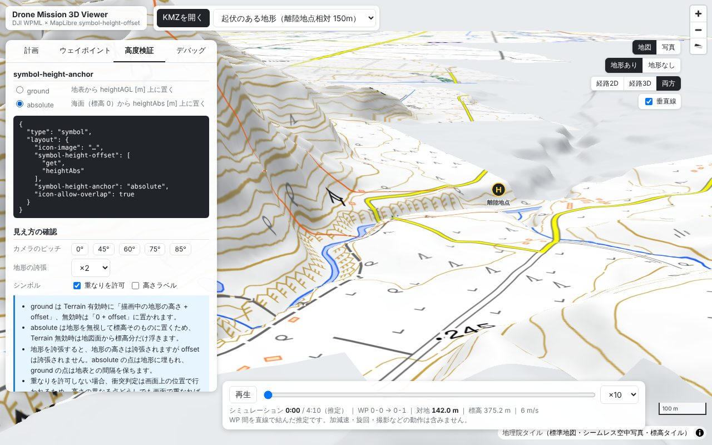 |

- MapLibre の実装（`symbol_elevation.ts`）では、`ground` は「誇張後の地形の高さ + offset」、`absolute` は「offset」。offset は誇張されない。
- ×2 にすると、`ground` の点は地表との間隔（AGL）を保ったまま地形と一緒に持ち上がる。`absolute` の点は地形に埋もれて見えなくなった。
- 高度の検証では誇張を ×1 にしておく必要がある。

## 4. ピッチによる見え方

| ピッチ 0° | ピッチ 75° |
|---|---|
| 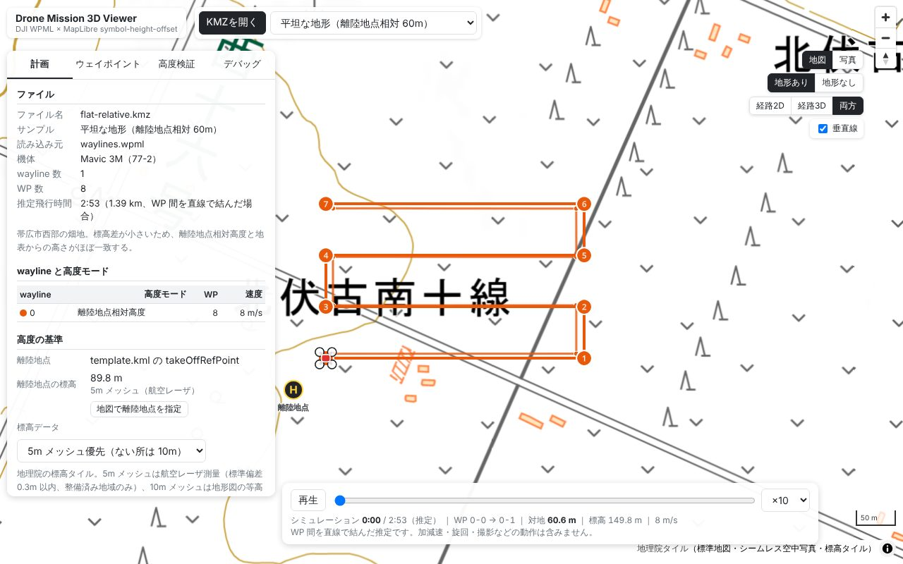 | 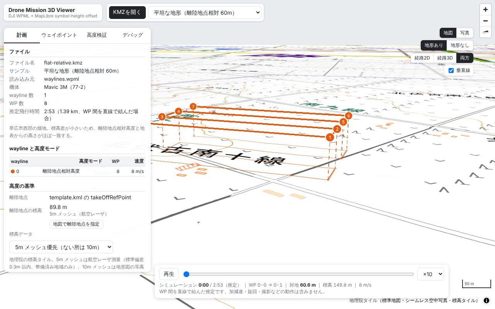 |

- 真上から見ても、透視投影のため画面中心から離れた点ほど空中のシンボルが地表の経路から外側にずれる。高さ 60m、ズーム 16 でも数ピクセル〜十数ピクセルずれる。
- ピッチを上げると高さの差が見やすくなる。75° 以上では奥の点どうしが画面上で詰まる。

## 5. アイコンの重なり

| 重なりを許可しない | 重なりを許可 |
|---|---|
| 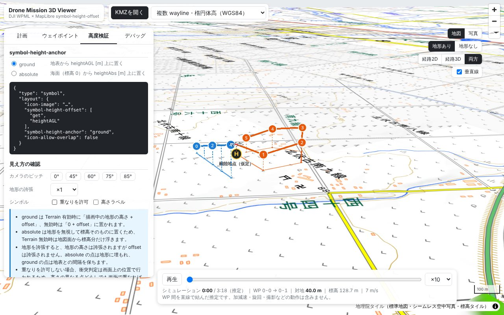 | 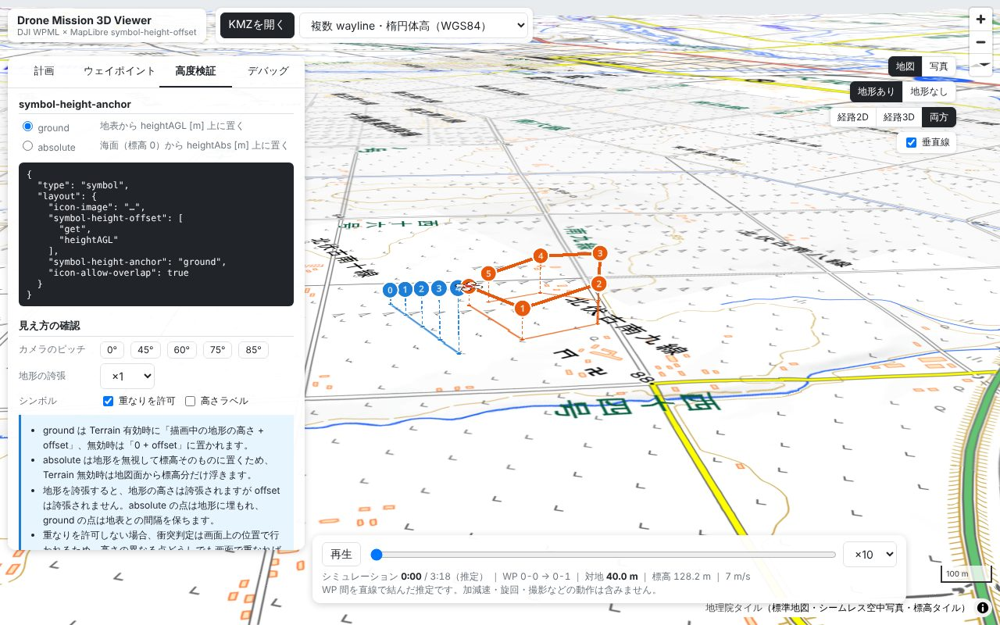 |

- 衝突判定は画面上の位置で行われる。高さの違う WP でも画面上で重なれば片方が非表示になる。
- 空中のシンボルは地表の点より画面上で動きやすいため、`icon-allow-overlap: true` を基本にし、`symbol-sort-key` で高い点を手前に描くようにした。

## 6. 2D ラインと 3D ライン

| 2D（line レイヤー） | 2D + 3D（Three.js） |
|---|---|
| 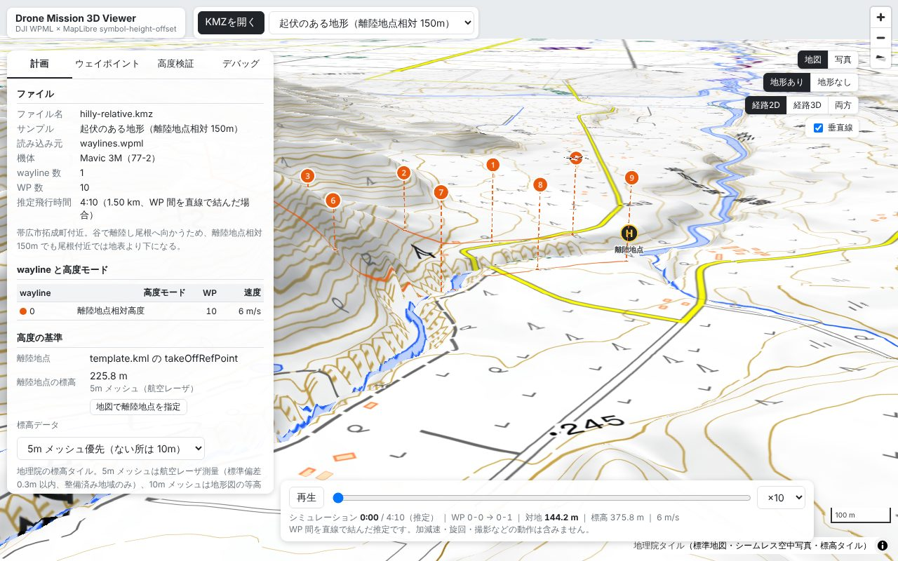 |  |

- MapLibre の line レイヤーは地表（Terrain）に沿って描かれ、高さを持てない。空中の WP と結ぶには Custom Layer が必要。
- 3D ラインは `renderingMode: '3d'` で深度バッファを共有するため、尾根の下をくぐる区間は地形に隠れる。
- ウェイポイント間を直線で結んだ線であり、実際の飛行軌跡ではない（旋回モードや機体制御で変わる）。

## 7. 高度モードごとの扱い

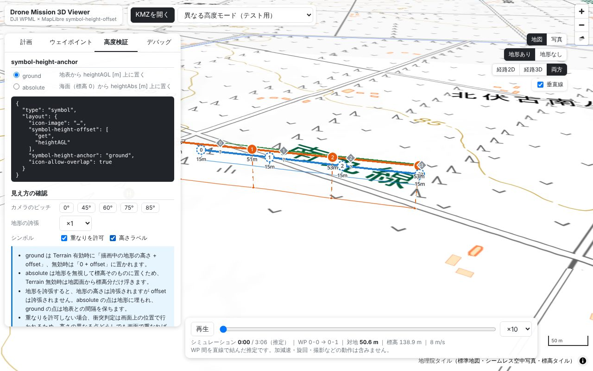

| モード | 表示 |
|---|---|
| 離陸地点相対（wayline 0） | 塗りつぶしの円（確定） |
| リアルタイム地表追従（wayline 1） | 白抜きの破線円（参考）。値を AGL とみなして表示 |
| 未知のモード（wayline 2） | 灰色の菱形。高さに換算せず地表に置く |

### 楕円体高（WGS84）とジオイド高

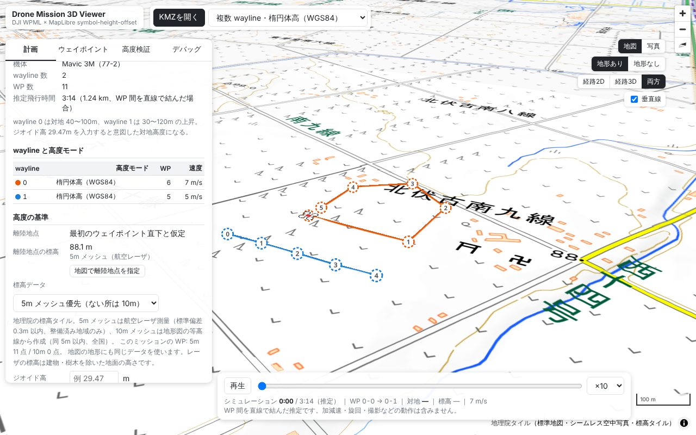

- 楕円体高は、ジオイド高（帯広付近で約 29.5m）を引かないと標高にならない。未入力のまま offset に入れると約 30m 高く表示される。
- ジオイド高が未入力のときは地表に「参考」として置き、注意書きを出すようにした。
- ジオイド高 29.47m を入力すると、サンプルで意図した対地高度（wayline 0: 40/60/80/100/80/60m、wayline 1: 30〜120m）と 0.01m 以内で一致した。

## 8. DEM と queryTerrainElevation() の比較

- 高度変換には地理院 DEM（z14）を直接読んで双線形補間した値を使った。
- 地図をズーム 15.5〜16 で表示した状態では、`map.queryTerrainElevation()` の値は DEM の値と 0.01m 以内で一致した（3 サンプル 29 点）。Terrain ソースの maxzoom を 14 にしているため、同じタイルを参照している。
- ズームを下げると描画中の地形タイルが粗くなり、差が大きくなる。ズーム 11 で −19.9〜+8.2m、ズーム 13 の計測では最大 135m の差が出た（このときはタイルの読み込みが終わっておらず、より粗いタイルで代用されていたと考えられる）。
- `queryTerrainElevation()` は Terrain 無効時に `null` を返し、値も表示状態に左右されるため、高度換算には向かない。

## 9. DEM の解像度による差

地理院の標高タイルには複数の元データがある。本アプリは全国で使える `dem_png`（z14 まで、10m メッシュ DEM10B）を使っている。

| データ | タイル | 作成方法 | 標高点の標準偏差 |
|---|---|---|---|
| DEM10B（約 10m） | `dem_png` z0–14 | 2.5 万分 1 地形図の等高線 | 5m 以内 |
| DEM5A（約 5m） | `dem5a_png` z15 | 航空レーザ測量 | 0.3m 以内 |
| DEM1A（約 1m） | `dem1a_png` z17 | 航空レーザ測量 | 提供地域が限られる |

サンプル地点ではいずれも 5m・1m メッシュが提供されていたため、`scripts/compare-dem.ts` で比較した（単位 m）。

| 地点 | DEM10B | DEM5A | DEM1A |
|---|---|---|---|
| 起伏地 離陸地点 | 225.15 | 225.85 | 225.97 |
| 起伏地 WP0 | 233.16 | 231.67 | 231.54 |
| 起伏地 WP2 | 271.18 | 275.44 | NA |
| 起伏地 WP4 | 401.73 | 410.30 | 410.02 |
| 起伏地 WP5 | 422.16 | 419.38 | 419.26 |
| 起伏地 WP6 | 295.24 | 303.09 | 303.51 |
| 起伏地 WP7 | 223.23 | 207.88 | NA |
| 平坦地 離陸地点 | 92.20 | 89.81 | 89.77 |
| 平坦地 WP0〜7 | 88.39〜91.72 | 86.91〜90.23 | 86.92〜90.18 |

- 平坦地でも DEM10B は DEM5A より一様に 1.3〜3.2m 高い。離陸地点相対の場合、離陸地点と WP が同じだけずれるため AGL への影響は小さい。
- 起伏地では最大 15.4m（WP7、川沿い）の差がある。WP4 の AGL は DEM10B で −26.6m、DEM5A で −34.4m。
- DEM5A と DEM1A の差は 0.6m 以内。
- 航空レーザの DEM は建物・樹木を除いた地表面。樹冠や作物の上を飛ぶ場合、障害物との間隔は AGL より小さい。

## 10. 鉛直基準について残る誤差

| 要因 | 大きさの目安 | 対応 |
|---|---|---|
| DJI の EGM96 と地理院 DEM（日本のジオイド）の違い | 1m 程度以内（未計測） | 補正せず注記 |
| DEM の解像度（DEM10B、約 10m メッシュ） | 平坦地で 1〜3m、起伏地で最大 15m 程度（9 章） | 補正なし。DEM5A への切り替えは今後の課題 |
| 離陸地点の高さ（気圧高度計の基準、建物の屋上からの離陸など） | ケースによる | 地図で離陸地点を指定可能。`takeOffRefPointAGLHeight` は使わない |
| 地表追従・作物や樹冠 | 作物高・樹高 | 参考表示 |
